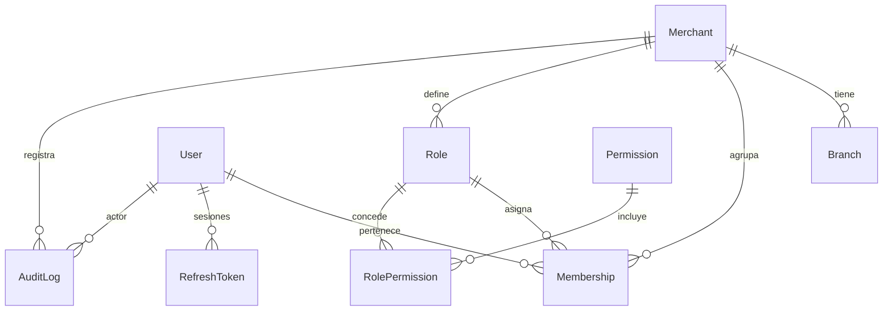
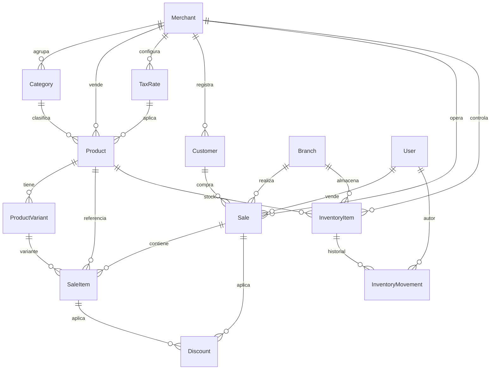
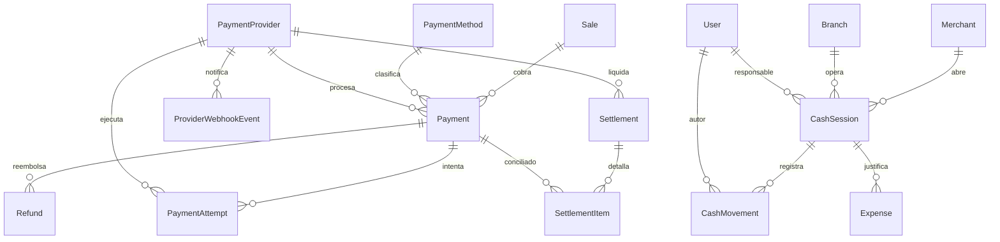

# Modelo de datos — Núcleo comercial del MVP

Proyecto: **PostAi** (`postai`), del **Equipo PostAi**. Base de datos:
`postai`.

- **Estado:** Aprobado con supuestos (`ARQ-002`, `ADR-002`)
- **Fecha:** 2026-11-06
- **Alcance:** núcleo comercial, pagos, caja y auditoría del MVP Android.
- **Esquema ejecutable:** [`apps/api/prisma/schema.prisma`](../../apps/api/prisma/schema.prisma)
- **Relacionado:** `PROJECT_CONTEXT.md`, `docs/api/README.md`,
  `docs/security/README.md`

> Este documento define el modelo **conceptual y lógico**. El esquema Prisma
> ejecutable vive en el backend; no contiene detalles de ningún SDK real.

## 1. Alcance

### Incluido en el MVP

- Comercio, sucursal por defecto, usuarios, roles y permisos.
- Catálogo: categorías, productos, servicios y variantes básicas.
- Impuestos simples y descuentos manuales.
- Inventario básico por producto y sucursal, con historial de movimientos.
- Clientes básicos.
- Ventas, ítems de venta y comprobante.
- Pagos: efectivo, transferencia, tarjeta SoftPOS real y tarjeta simulada.
- Intentos de pago, reembolsos y webhooks del proveedor.
- Liquidaciones y conciliación (modeladas; UI/operación pueden ir a fase 2).
- Caja: apertura, cierre, movimientos y gastos.
- Auditoría de acciones relevantes.

### Fuera de alcance del modelo actual

- Fidelización, cupones y metas comerciales.
- Multi-moneda.
- Compras, proveedores y órdenes de compra.
- Contabilidad e integración contable.
- Facturación electrónica y requisitos fiscales específicos.
- Multi-sucursal avanzada (se modela `Branch`, pero el MVP opera una sola).
- Variantes avanzadas de inventario (el MVP controla stock por producto).
- IA y analítica avanzada.

## 2. Principios y decisiones

| Tema | Decisión |
| --- | --- |
| Identificadores | UUID v4 (`uuid()`). Evaluar UUIDv7 por localidad de índice más adelante. |
| Dinero | `BigInt` en **unidad mínima** + `currency` ISO 4217 (`CHAR(3)`). Evita el límite de `Int` y errores de coma flotante. |
| Moneda del MVP | `COP` en **pesos enteros** (exponente 0): `$10.000` = `10.000`. Desviación consciente de ISO 4217; ver [ADR-002](../architecture/ADR-002-supuestos-mvp.md). |
| Cantidades | `Decimal(14,3)` para permitir granel o fracciones. |
| Multi-tenant | `merchantId` en toda entidad de negocio. Toda consulta se filtra por comercio. |
| Sucursal | `Branch` obligatoria; al crear el comercio se crea una sucursal `MAIN`. |
| Historial | Las ventas guardan **snapshot** de nombre, SKU, precio, impuesto y descuento. Cambiar el catálogo no altera ventas pasadas. |
| Borrado | No se borran ventas, pagos, reembolsos, liquidaciones ni movimientos. Catálogo y clientes usan `isActive`/estado. |
| Proveedor | Campos genéricos (`providerPaymentId`, `providerReference`) que se adaptarán al SDK real. Sin nombres de métodos inventados. |
| Tarjetas | Nunca se almacenan PAN, CVV, PIN ni credenciales sensibles. |
| Fechas | UTC en base de datos; `timezone` del comercio para reportes. |
| Simulación | `Payment.isSimulated` distingue pagos simulados de reales. Un pago simulado no genera liquidación. |
| Secretos | `PaymentProvider.configRef` referencia un secreto externo; no guarda credenciales. |
| Idempotencia | Clave única por comercio en ventas, pagos y reembolsos. |
| Autoría | Acciones relevantes registran usuario y quedan en `AuditLog`. |

### Fórmulas de importes

- `item.grossMinor = unitPriceMinor × quantity`
- `item.lineTotalMinor = grossMinor − item.discountMinor + item.taxMinor`
- `sale.subtotalMinor = Σ item.grossMinor`
- `sale.discountMinor = Σ descuentos de ítem + descuentos de venta`
- `sale.taxMinor = Σ impuestos de ítem`
- `sale.totalMinor = subtotalMinor − discountMinor + taxMinor`

El MVP asume impuestos **agregados al precio** (exclusivos). Los impuestos
incluidos en el precio quedan como pregunta abierta.

## 3. Diagramas entidad-relación

### 3.1. Acceso y multi-tenant



### 3.2. Catálogo, inventario y ventas



### 3.3. Pagos, liquidaciones y caja



## 4. Diccionario de entidades

### 4.1. Acceso y multi-tenant

| Entidad | Propósito | Campos y reglas clave |
| --- | --- | --- |
| `Merchant` | Comercio. Raíz del tenant. | `name`, `legalName?`, `taxId?`, `currency`, `timezone`, `status`, `settings JSON`. |
| `Branch` | Sucursal operativa. | `merchantId`, `code`, `name`, `isActive`. Único `(merchantId, code)`. En MVP se crea `MAIN`. |
| `User` | Persona con acceso. | `email` único global, `passwordHash`, `fullName`, `status`. Sin datos de tarjeta. |
| `Membership` | Pertenencia de un usuario a un comercio. | `userId`, `merchantId`, `roleId`, `status`. Único `(userId, merchantId)`. Permite que un usuario trabaje en varios comercios. |
| `Role` | Rol configurable por comercio. | `merchantId`, `name`, `code`, `isSystem`. Se siembran `OWNER`, `ADMIN`, `CASHIER`, `SELLER`, `ACCOUNTANT`. |
| `Permission` | Catálogo global de permisos. | `code` único (por ejemplo `sales.create`, `refunds.create`). |
| `RolePermission` | Permisos concedidos a un rol. | Clave compuesta `(roleId, permissionId)`. |
| `RefreshToken` | Sesión renovable. | `userId`, `tokenHash` único, `expiresAt`, `revokedAt`. Nunca se guarda el token en claro. |
| `AuditLog` | Bitácora de acciones relevantes. | `merchantId?`, `actorUserId?`, `action`, `entityType`, `entityId`, `metadata JSON` sanitizado, `ipAddress?`, `userAgent?`. |

### 4.2. Catálogo e inventario

| Entidad | Propósito | Campos y reglas clave |
| --- | --- | --- |
| `Category` | Categoría de productos. | `merchantId`, `name`, `color?`, `sortOrder`. Único `(merchantId, name)`. |
| `Product` | Producto o servicio vendible. | `type` (`PRODUCT`/`SERVICE`), `name`, `sku?`, `barcode?`, `priceMinor`, `currency`, `taxRateId?`, `trackInventory`, `isActive`. Precio en unidad mínima. |
| `ProductVariant` | Variante básica. | `productId`, `name`, `sku?`, `priceMinor?`. Modelada; el MVP puede no exponerla. |
| `TaxRate` | Impuesto configurable. | `merchantId`, `name`, `rateBp` (puntos base, `1900` = 19 %), `isDefault`, `isActive`. |
| `InventoryItem` | Stock actual por producto y sucursal. | `branchId`, `productId`, `quantity Decimal`, `lowStockThreshold?`. Único `(branchId, productId)`. |
| `InventoryMovement` | Historial de entradas y salidas. | `type`, `quantityDelta` con signo, `previousQuantity`, `newQuantity`, `referenceType?`, `referenceId?`, `reason?`, `createdByUserId?`. Inmutable. |

### 4.3. Clientes y ventas

| Entidad | Propósito | Campos y reglas clave |
| --- | --- | --- |
| `Customer` | Cliente del comercio. | `name`, `email?`, `phone?`, `taxId?`, `notes?`. Contacto opcional; no bloquea el cobro. |
| `Sale` | Venta registrada. | `merchantId`, `branchId`, `sellerUserId`, `customerId?`, `status`, `currency`, `subtotalMinor`, `discountMinor`, `taxMinor`, `totalMinor`, `refundedMinor`, `receiptNumber?`, `idempotencyKey?`, `completedAt?`. |
| `SaleItem` | Línea de venta con snapshot. | `productId`, `variantId?`, `productName`, `sku?`, `quantity`, `unitPriceMinor`, `discountMinor`, `taxRateBp`, `taxMinor`, `lineTotalMinor`. |
| `Discount` | Descuento aplicado. | `type` (`PERCENT`/`AMOUNT`), `percentBp?`, `amountMinor`, `reason?`, `saleItemId?` (nulo = descuento de venta), `createdByUserId?`. |

### 4.4. Pagos y conciliación

| Entidad | Propósito | Campos y reglas clave |
| --- | --- | --- |
| `PaymentMethod` | Método habilitado por comercio. | `code` (por ejemplo `CASH`, `TRANSFER`, `CARD_SOFTPOS`, `CARD_SIMULATED`), `type`, `isSimulated`, `requiresProvider`, `isActive`. Único `(merchantId, code)`. |
| `PaymentProvider` | Configuración del proveedor por comercio. | `code`, `name`, `mode` (`SANDBOX`/`PRODUCTION`), `status`, `configRef?` (referencia a secreto externo), `isDefault`. Único `(merchantId, code, mode)`. |
| `Payment` | Pago lógico de una venta. | `saleId`, `methodId`, `providerId?`, `status`, `amountMinor`, `isSimulated`, `idempotencyKey`, `providerPaymentId?`, `failureCode?`, `refundedMinor`, `approvedAt?`. |
| `PaymentAttempt` | Intento técnico de cobro. | `paymentId`, `providerId?`, `attemptNumber`, `status`, `providerReference?`, `requestPayload?`, `responsePayload?`, `errorCode?`, `startedAt`, `finishedAt?`. Payloads sanitizados. |
| `ProviderWebhookEvent` | Evento recibido del proveedor. | `providerId`, `externalEventId`, `eventType`, `payload`, `signatureVerified`, `status`, `processedAt?`, `errorMessage?`. Único `(providerId, externalEventId)`. |
| `Refund` | Reembolso total o parcial. | `paymentId`, `status`, `amountMinor`, `reason?`, `providerRefundId?`, `idempotencyKey`, `createdByUserId?`, `approvedAt?`. |
| `Settlement` | Liquidación del proveedor. | `providerId`, `externalId`, `periodStart`, `periodEnd`, `grossMinor`, `feeMinor`, `netMinor`, `currency`, `status`, `settledAt?`. Único `(providerId, externalId)`. |
| `SettlementItem` | Detalle de pagos conciliados. | `settlementId`, `paymentId`, `grossMinor`, `feeMinor`, `netMinor`. Único `(settlementId, paymentId)`. |

### 4.5. Caja y gastos

| Entidad | Propósito | Campos y reglas clave |
| --- | --- | --- |
| `CashSession` | Apertura y cierre de caja. | `branchId`, `status`, `openedByUserId`, `openedAt`, `openingAmountMinor`, `closedByUserId?`, `closedAt?`, `closingAmountMinor?`, `expectedAmountMinor?`, `differenceMinor?`. Una sola sesión `OPEN` por sucursal. |
| `CashMovement` | Movimiento de efectivo. | `sessionId`, `type`, `direction` (`IN`/`OUT`), `amountMinor`, `referenceType?`, `referenceId?`, `description?`, `createdByUserId?`. |
| `Expense` | Gasto del comercio. | `branchId`, `sessionId?`, `category`, `amountMinor`, `currency`, `description?`, `incurredAt`, `createdByUserId`. |

## 5. Estados y transiciones

### 5.1. Venta (`SaleStatus`)

| Desde | Hacia | Condición |
| --- | --- | --- |
| — | `DRAFT` | Venta creada sin pago. |
| `DRAFT` | `PENDING_PAYMENT` | Se inicia el checkout. |
| `PENDING_PAYMENT` | `PAID` | Pagos aprobados cubren `totalMinor`. |
| `PENDING_PAYMENT` | `CANCELLED` | Se abandona o anula sin pago aprobado. |
| `PAID` | `PARTIALLY_REFUNDED` | `0 < refundedMinor < totalMinor`. |
| `PAID` / `PARTIALLY_REFUNDED` | `REFUNDED` | `refundedMinor = totalMinor`. |
| `DRAFT` / `PENDING_PAYMENT` | `CANCELLED` | Sin pagos aprobados. |

Regla: una venta `PAID` **no se cancela**; se reembolsa. No se permite volver de
`PAID` a `PENDING_PAYMENT`.

### 5.2. Pago (`PaymentStatus`)

| Desde | Hacia | Condición |
| --- | --- | --- |
| — | `CREATED` | Pago registrado localmente. |
| `CREATED` | `PENDING` | Enviado al proveedor o en espera. |
| `PENDING` / `PROCESSING` | `APPROVED` | Resultado verificado con el proveedor. |
| `PENDING` / `PROCESSING` | `REJECTED` | Rechazo confirmado. |
| `CREATED` / `PENDING` / `PROCESSING` | `CANCELLED` | Cancelación permitida por el proveedor o abandono. |
| `APPROVED` | `PARTIALLY_REFUNDED` | `0 < refundedMinor < amountMinor`. |
| `APPROVED` / `PARTIALLY_REFUNDED` | `REFUNDED` | `refundedMinor = amountMinor`. |

Reglas:

- `APPROVED` solo se alcanza con verificación del backend, nunca por decisión
  del móvil.
- Un pago `REJECTED` o `CANCELLED` es terminal; se crea un pago/intento nuevo.
- Los estados mostrados por el SDK son insumos; el backend confirma el estado
  final.

### 5.3. Reembolso (`RefundStatus`)

`CREATED → PENDING → PROCESSING → APPROVED | REJECTED | CANCELLED`

Solo se reembolsa si el proveedor y el contrato lo permiten.

### 5.4. Liquidación (`SettlementStatus`)

`PENDING → PAID | FAILED`

### 5.5. Caja (`CashSessionStatus`)

`OPEN → CLOSED`. No se reabre; cualquier corrección se registra como
movimiento de ajuste.

## 6. Invariantes y reglas de negocio

1. Todo registro de negocio pertenece a un `merchantId`; no hay consultas
   globales sin filtro de comercio.
2. `Payment.amountMinor > 0` y `Refund.amountMinor > 0`.
3. `Payment.refundedMinor ≤ Payment.amountMinor`.
4. `Sale.refundedMinor ≤ Sale.totalMinor`.
5. La suma de pagos `APPROVED` de una venta no puede superar `totalMinor`.
   En el MVP se exige **un solo pago por venta**; el modelo admite varios.
6. Una venta pasa a `PAID` solo cuando la suma aprobada cubre `totalMinor`.
7. Un pago real `APPROVED` debe tener referencia del proveedor; un pago
   simulado debe tener `isSimulated = true` y no generar liquidaciones.
8. `currency` debe coincidir entre comercio, venta, pago y reembolso.
9. `idempotencyKey` es única por comercio en ventas, pagos y reembolsos.
10. Las ventas y pagos no se eliminan; se anulan o reembolsan con trazabilidad.
11. El inventario se descuenta en la misma transacción que confirma la venta,
    solo para productos con `trackInventory = true`.
12. No se permite stock negativo salvo configuración explícita del comercio.
13. Solo puede existir una `CashSession` con estado `OPEN` por sucursal.
14. `CashSession.differenceMinor = closingAmountMinor − expectedAmountMinor`.
15. Los movimientos de inventario y caja son inmutables.
16. Toda acción sensible (anulación, reembolso, ajuste, cambio de permisos,
    cierre de caja) genera `AuditLog`.
17. Nunca se persisten PAN, CVV, PIN ni credenciales. Los payloads del
    proveedor se sanitizan antes de guardarse.
18. Los pagos simulados se muestran como simulados en UI, recibos y reportes.

## 7. Idempotencia y concurrencia

| Operación | Clave única | Comportamiento |
| --- | --- | --- |
| Crear venta | `(merchantId, idempotencyKey)` | Si la clave existe, devolver la venta existente. |
| Crear pago | `(merchantId, idempotencyKey)` | Si la clave existe, devolver el pago existente; no reenviar al proveedor. |
| Crear reembolso | `(merchantId, idempotencyKey)` | Igual que el pago. |
| Intento de pago | `(paymentId, attemptNumber)` | Numeración secuencial por pago. |
| Webhook | `(providerId, externalEventId)` | Si ya fue procesado, responder OK sin reprocesar. |
| Conciliación | `(settlementId, paymentId)` | Evita duplicar el detalle. |

Recomendaciones:

- Bloquear la fila del pago (`SELECT ... FOR UPDATE`) al aplicar el resultado de
  un webhook.
- Verificar el resultado con el proveedor antes de aprobar si el webhook es
  dudoso o extemporáneo.
- Guardar el hash del payload para detectar eventos manipulados.
- Si el proveedor no entrega un ID de evento, usar un hash determinista del
  payload como `externalEventId` (documentarlo).

## 8. Índices y restricciones

Índices principales:

- `sales (merchant_id, created_at)`, `sales (merchant_id, status)`.
- `payments (sale_id)`, `payments (merchant_id, status)`,
  `payments (merchant_id, created_at)`.
- `payment_attempts (provider_id, provider_reference)`.
- `payments (provider_id, provider_payment_id)` único cuando ambos no son nulos.
- `refunds (payment_id)`.
- `provider_webhook_events (provider_id, status)`.
- `settlements (merchant_id, period_start)`.
- `inventory_movements (inventory_item_id, created_at)`.
- `cash_movements (session_id)`.
- `audit_logs (merchant_id, created_at)`, `audit_logs (entity_type, entity_id)`.
- `customers (merchant_id, name)`, `customers (merchant_id, phone)`.

`sku`, `barcode`, `receiptNumber` e `idempotencyKey` se declaran únicos en
Prisma. PostgreSQL trata cada `NULL` como distinto, por lo que se permiten
varios registros sin valor pero se exige unicidad cuando el valor existe.

Restricciones que Prisma no expresa y deben añadirse en la migración SQL:

```sql
-- Una sola caja abierta por sucursal.
CREATE UNIQUE INDEX cash_sessions_one_open_per_branch
  ON cash_sessions (branch_id) WHERE status = 'OPEN';

-- Importes y reembolsos coherentes.
ALTER TABLE payments
  ADD CONSTRAINT payments_amount_positive CHECK (amount_minor > 0),
  ADD CONSTRAINT payments_refunded_within_amount
    CHECK (refunded_minor >= 0 AND refunded_minor <= amount_minor);

ALTER TABLE sales
  ADD CONSTRAINT sales_total_non_negative CHECK (total_minor >= 0),
  ADD CONSTRAINT sales_refunded_within_total
    CHECK (refunded_minor >= 0 AND refunded_minor <= total_minor);

ALTER TABLE refunds
  ADD CONSTRAINT refunds_amount_positive CHECK (amount_minor > 0);
```

## 9. Seguridad y retención

- `passwordHash` con Argon2id o bcrypt; nunca contraseñas en claro.
- `RefreshToken.tokenHash` con hash criptográfico; rotación y revocación.
- Payloads de proveedor: guardar solo campos necesarios y sanitizados.
- `PaymentProvider.configRef` apunta a un gestor de secretos o variable de
  entorno; la base de datos no almacena credenciales.
- `AuditLog.metadata` no incluye datos personales innecesarios ni datos de
  tarjeta.
- Retención de ventas, pagos y auditoría según política contable/legal a
  definir. No borrar registros financieros desde la aplicación.
- Los reportes usan `Merchant.timezone`; la base de datos guarda UTC.

## 10. MVP vs. fases posteriores

| Elemento | MVP | Nota |
| --- | --- | --- |
| `ProductVariant` | Modelado, no expuesto | Se pospone la UI de variantes. |
| `Settlement` / `SettlementItem` | Modelado, sin UI | Conciliación se valida con el proveedor real. |
| Multi-sucursal | Modelado, una sola | `MAIN` por defecto. |
| Pagos divididos | No expuesto | El modelo soporta varios; la API MVP exige uno. |
| Reembolsos parciales | No expuesto | El modelo los soporta; MVP solo totales. |
| Impuestos múltiples/compuestos | No | Un `TaxRate` por producto, agregado al precio. |
| Descuentos | Solo a nivel de venta | Sin cupones ni descuentos por ítem en la UI. |
| Vuelto en efectivo | No se almacena | La UI lo calcula; el pago registra el total. |
| Facturación electrónica | No | Comprobante interno no fiscal; validar DIAN aparte. |
| Multi-moneda | No | Una moneda por comercio. |

## 11. Decisiones tomadas y pendientes

Los supuestos pragmáticos del MVP están registrados en
[ADR-002](../architecture/ADR-002-supuestos-mvp.md). Resumen:

| Tema | Decisión MVP |
| --- | --- |
| Moneda | COP en pesos enteros (exponente 0). |
| Impuestos | Un `TaxRate` por producto, agregado al precio; por defecto 0 %. |
| Facturación electrónica / DIAN | Fuera de alcance; comprobante interno no fiscal. |
| Sucursales | Una `MAIN`; multi-sucursal solo modelada. |
| Pagos por venta | Uno; el modelo soporta varios. |
| Reembolsos | Totales; parciales solo modelados. |
| Stock negativo | Bloqueado. |
| Vuelto | No se almacena; se calcula en la UI. |
| Descuentos | Solo a nivel de venta; sin cupones. |
| Variantes | Modeladas, no expuestas. |
| Liquidaciones | Modeladas, sin UI. |
| Retención | Conservar registros; definir política antes de producción. |

### Pendientes que dependen de terceros

1. **Conciliación y webhooks reales:** se adaptarán a la documentación del
   proveedor (`ARQ-004`).
2. **Reembolsos reales:** confirmar soporte y modelo del proveedor.
3. **Facturación electrónica / DIAN:** validar con contador/abogado.
4. **Certificaciones y publicación:** validar con proveedor y adquirente.
5. **Retención y privacidad:** definir política antes de producción.

## 12. Relación con la API

- Contrato: [`docs/api/openapi.yaml`](../api/openapi.yaml).
- Los importes se serializan como **string** (pesos enteros COP) para evitar
  ambigüedad y pérdida de precisión.
- Los estados se exponen con los mismos códigos del modelo.
- Las operaciones de venta, pago y reembolso reciben `Idempotency-Key`.
- Los listados se filtran por comercio y se paginan con `page`/`pageSize`.
- Flujos y convenciones: [`docs/api/README.md`](../api/README.md).
